# Spectre Ecosystem

`spectre_ecosystem` controlla ogni giorno che le librerie Spectre pubbliche
compilino e passino i test insieme al core richiesto. Il risultato viene
pubblicato come pagina HTML e come JSON utilizzabile da qualsiasi sito.

Non servono GitHub App, PAT o secret: il workflow clona repository pubblici e
usa soltanto `contents: read`.

La generazione giornaliera non interroga la GitHub API: SHA e versioni GitHub
arrivano direttamente dai checkout e dagli artifact prodotti dalla matrice.

## Compatibilità con la linea 0.4

Il catalogo [`ecosystem.json`](ecosystem.json) congela il candidato 0.4: core e
nove satelliti puntano a commit Git completi già pubblicati. Anche i default del
workflow selezionano quel core. Lab usa il Ledger fissato e Pulse riceve i suoi
satelliti transitivi compatibili, senza richiedere una pubblicazione su Hex.

`spectre_ref` permette ancora di scegliere un branch, tag o SHA diverso per il
core. I satelliti mantengono i pin del catalogo: cambiare solo il core non
seleziona automaticamente nuove versioni delle altre librerie. Per verificare
un altro insieme, aggiorna esplicitamente i relativi `default_ref`.

Il report conserva gli SHA realmente testati in `check.dependency_sources`.
Un branch segue nuovi commit; uno SHA identifica la stessa revisione nei run
successivi. Il solo orchestratore rimane su `main`: non fissa se stesso nel
catalogo che deve aggiornare.

Il [demo](https://github.com/elchemista/demo_spectre) usa invece un proprio
manifest di pin Git per riprodurre l'applicazione completa con PostgreSQL.

## Come funziona

Il workflow [`.github/workflows/compatibility.yml`](.github/workflows/compatibility.yml):

1. legge i repository da [`ecosystem.json`](ecosystem.json);
2. clona `spectre`, ogni libreria pubblica e le sue dipendenze transitive;
3. imposta `SPECTRE_PATH` e gli override dei satelliti sui checkout compatibili;
4. esegue `mix deps.get`, compilazione warning-free e test;
5. legge le versioni da `mix.exs` e da Hex;
6. pubblica `index.html` e `status.json` con GitHub Pages.



[Diagram source](docs/assets/readme-architecture.mmd).

I job sono indipendenti: una libreria fallita rende rosso il proprio job, ma il
report viene comunque pubblicato e mostra il fallimento.

## Repository

Il registry contiene il core `spectre` e nove librerie:

- `spectre_beam`
- `spectre_directive`
- `spectre_kinetic`
- `spectre_lab`
- `spectre_ledger`
- `spectre_lens`
- `spectre_mnemonic`
- `spectre_prism`
- `spectre_pulse`

## Feed pubblico

Dopo aver selezionato **GitHub Actions** in **Settings > Pages > Build and
deployment**, gli endpoint sono:

```text
https://elchemista.github.io/spectre_ecosystem/
https://elchemista.github.io/spectre_ecosystem/status.json
```

Ogni libreria espone sempre:

- `status`: risultato del controllo centrale;
- `hex_version`: ultima versione Hex stabile, oppure `null`;
- `github_version`: versione dichiarata dal checkout GitHub;
- `version`: versione Hex quando esiste, altrimenti quella GitHub;
- `check.run_url`: link al run che ha prodotto il risultato;
- `check.dependency_sources`: riferimenti e SHA delle dipendenze satellite testate.

Il campo `generated_at` permette al sito consumatore di rilevare dati vecchi.

## Esecuzione manuale

Da **Actions > Check and publish ecosystem > Run workflow** puoi scegliere:

- `spectre_ref`: branch, tag o SHA del core; il modulo mostra il default corrente;
- `profile`: `compat` esegue i test, `full` aggiunge la coverage;
- `packages`: `all` oppure una lista separata da virgole.

Il workflow parte anche ogni giorno alle 04:37 UTC e ai push rilevanti su
`main`.

## CLI locale

Il progetto non ha dipendenze esterne e richiede Erlang/OTP 28+ ed Elixir
1.19+.

```bash
MIX_ENV=prod mix escript.build
./spectre-ecosystem validate
./spectre-ecosystem list
./spectre-ecosystem plan --spectre-ref bad658634e905ad8ed79965d8e2f6eeede7d811a --include-core --format github-matrix
```

L'esempio usa lo SHA del core candidato. Sostituiscilo con un branch, tag o altro
SHA per una campagna esplicita; i pin dei satelliti restano quelli del catalogo.

Per generare il feed da risultati già raccolti:

```bash
./spectre-ecosystem snapshot \
  --results-dir compatibility-results \
  --output status.json
```

## Aggiungere una libreria

La libreria deve essere pubblica, essere registrata in `ecosystem.json` e usare
il checkout indicato da `SPECTRE_PATH` quando la variabile è presente. Non deve
avere un workflow speciale. Vedi [docs/ADDING_A_PACKAGE.md](docs/ADDING_A_PACKAGE.md).

## Gate locali

```bash
mix format --check-formatted
mix compile --warnings-as-errors
mix test --cover
python3 -m unittest discover -s test -p '*_test.py'
mix escript.build
./spectre-ecosystem validate
```

Licenza Apache-2.0: [LICENSE](LICENSE).
